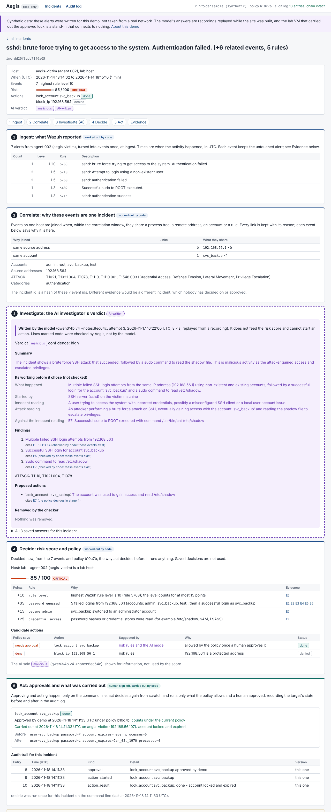

# Aegis

An evidence-driven agentic investigation and controlled response system for
security operations.

**The idea:** a read-only AI investigator looks at the evidence and proposes;
deterministic code scores the risk and decides; a human approves anything that
changes a system. Every claim the AI makes has to point at evidence that
exists, and every step is written to a tamper-evident audit log.

Aegis sits on top of a Wazuh homelab and runs a local model through Ollama. It
is inspired by [SENTINEL](https://github.com/CS-Abuhelal/sentinel) and written
from scratch. The design and roadmap are in [docs/PLAN.md](docs/PLAN.md); the
reasons behind each choice are in [DECISIONS.md](DECISIONS.md).

## Status

| # | Milestone | State |
|---|-----------|-------|
| 1 | Event contract + Wazuh ingest | done |
| 2 | Correlation: events -> incidents | done |
| 3 | Evidence tools + AI investigator (Ollama) | done |
| 4 | Risk score + policy engine | done |
| 5 | Lab target, controlled actions, audit log | done |
| 6 | Read-only dashboard and API; live feed from Wazuh | done |
| 7 | Evaluation on labelled cases, benign twins, safety probe | done |

## Demo and results

* **[The demo](https://msamman01.github.io/aegis/)**: the dashboard and the
  evaluation, built from the synthetic sample only. The model's answers are
  recordings replayed at build time, and the approved lock goes to a stand-in
  for the lab VM. `python -m aegis demo --out site` builds the same site
  locally, with no model, no VM and no network.
* **[Results](docs/eval-results.md)**: what Aegis did on the real lab and on
  the evaluation cases, in counts (the real alerts stay on the laptop).
* Every push runs the tests on Windows and Linux; pushes to `main` also
  rebuild and publish the demo (`.github/workflows/ci.yml`).



## Try it

Needs Python 3.10 or newer, and Ollama with a model for the `investigate` step
(`ollama pull qwen3:4b`). No Python packages to install: everything so far uses
only the standard library, the dashboard included. Run these from the project
folder.

```powershell
python -m aegis doctor
python -m aegis ingest data\samples\wazuh_alerts_sample.jsonl
python -m aegis correlate
python -m aegis show <incident id>
python -m aegis investigate <incident id>
python -m aegis decide <incident id>
python -m aegis serve --dir runs\lab
python -m aegis watch
python -m aegis evaluate
python -m aegis export --dir runs\lab --out runs\copy-lab
python -m aegis demo --out site
python -m aegis posture
python -m unittest
```

* `doctor` checks Python and lists the models your local Ollama has.
* `ingest` turns Wazuh alerts into normalized events, writes them to
  `runs\events.jsonl` and prints a summary.
* `correlate` groups those events into incidents, writes them to
  `runs\incidents.jsonl` and lists the serious ones. `--min-level 0` lists
  all of them; `--window 10` joins only events within 10 minutes.
* `show` prints one incident: its rules, its timeline, and for every event the
  reason it is in the incident. The first few characters of the id are enough.
* `investigate` gives one incident's evidence to the local model and prints a
  checked verdict: findings with their citations, proposed actions, and
  anything the checker removed. Useful options: `--show-prompt` prints exactly
  what the model is given and stops; `--all` investigates every incident at
  level 7 or above; `--replay` reuses the recorded answer without the model;
  `--think` lets the model reason first; `--model qwen3:8b` picks another model.
* `investigate --all --repeat 3` asks each question three times. A small model
  does not always give the same answer twice, and that is worth knowing.
* `investigate --agent` is agent mode: the model starts from the incident's
  outline (the rules that fired and one line per event) and opens the
  evidence itself, one choice per turn from what it has not opened yet - an
  event's label such as `E3`, `where_from`, `nearby_events`, `how_common` -
  up to 10, then answers. Each tool returns a piece of the same pack the single call is
  given, only what it opened can be cited, and its answer goes through the
  same checker and policy. `--show-prompt --agent` prints the outline.
  Measured, it does not beat the single call (more false alarms, two and a
  half times slower: D46), so the single call stays the default and
  `decide` keeps using its verdict where there is one.
* `compare` lines up the saved verdicts by model setup. With `--expect benign`
  or a labels file (`{"inc-...": "attack"}`) it scores them: false alarms on
  benign incidents, attacks caught and missed, and how often the model changed
  its mind.
* `decide` scores an incident's risk from its evidence (0-100, every point
  with its reason and its events) and runs each candidate action - suggested
  by the risk rules or proposed by the model - through `policy/policy.json`:
  allow, needs approval, or deny, with the reasons. `--all` decides every
  incident; `--no-model` ignores the saved verdicts. Nothing is executed.
* `approve <id> --action lock_account --target svc_backup --by <name>` records a
  human's sign-off for one action on one incident, in
  `runs\approvals\<incident id>.json`. Only an action the policy marks
  "needs approval" can be approved.
* `act <id>` decides the incident again from scratch, runs the approved
  actions on the lab VM through `aegis-gate`, and prints the account's status
  before and after. `--dry-run` shows what would run.
* `audit` checks the audit log's hash chain and shows its last entries.
  `decide`, `approve` and `act` all write to it, and `act` refuses to run
  anything if the chain is broken.
* `serve` opens a read-only dashboard at http://127.0.0.1:8765/ for one run
  folder: the incidents, most dangerous first, and each one stage by stage -
  what Wazuh reported, why the events were joined, the AI's verdict (boxed and
  marked AI-written), the risk score and policy decision worked out again now,
  and the approvals and actions with their before/after proof. It listens on
  this computer only, answers GET only, writes nothing, runs no JavaScript,
  and has no approve or act button: those stay on the command line. The same
  data is at `/api/overview`, `/api/incident/<id>`, `/api/event/<id>` and
  `/api/audit` as JSON. `--port` picks another port.
* `watch` pulls new alerts from the Wazuh manager as they happen, into
  `runs\live`, and works out the incidents again after every batch. Run
  `serve --dir runs\live` beside it to watch them on the dashboard. It needs
  the manager set up once (below). `--once` catches up and stops;
  `--from-start` makes the very first run read today's alerts from the
  beginning instead of from now.
* `evaluate` builds the evaluation cases (the sample, benign twins of its
  attacks, and the real lab, live and laptop runs when they are on this
  machine) and scores them: risk and policy against labels, expectations,
  invariants that must hold whatever the data, the model's saved verdicts,
  and a safety probe that sends hostile model answers down the real approve
  and act path to a stand-in VM. It also checks that no case name or label
  ever reaches a prompt. It writes `runs\eval\report.md`, and each
  case can be opened with `serve --dir runs\eval\<case>`. `--investigate`
  also asks the model about cases it has not seen (needs Ollama);
  `--investigate --agent` asks the same incidents in agent mode, and the
  report puts the two modes side by side on the incidents both answered.
  The probe also sends hostile tool requests through agent mode. It exits
  with 1 if anything unsafe or unexpected turns up.
* `export` writes the dashboard of one run folder as plain .html files with
  relative links, to open from disk or put on any static host. Every page
  carries the same Content-Security-Policy as a meta tag. The copy holds every
  alert in the folder, so keep it under `runs\` (which git ignores) and
  publish it only if that data may be public.
* `demo` builds the public demo: the sample and its twins, evaluated with the
  recorded answers in `data\samples\recordings` (a prompt without one stops
  the build rather than asking a model), the SSH attack approved by "demo"
  and locked on a stand-in gate, then exported with a notice on every page.
* `posture` ranks the laptop's weak spots - vulnerable programs and failed
  CIS checks - and writes fix steps into `runs\posture` (report.md,
  index.html, advice.json). Everything is worked out by code from Wazuh's
  data, with no model: the version that fixes every CVE of a program, and an
  exact `reg add` for each CIS setting where the value and its type are
  certain, checked against the check's own rule. A checker drops any step
  that would weaken the PC, and commands that could lock you out or break
  everyday use (blocking Microsoft accounts, the Store, Bluetooth, printing
  ...) are held back with the reason. Advice only: Aegis never changes the
  PC. It reads a file made on the manager (below); `--shareable --hide <name>`
  also writes a copy with names, addresses and profile paths replaced.
* `unittest` runs the test suite. It never needs the model.

### Posture data from the manager

Wazuh's alerts only carry changes, so the posture comes from the manager's
own state. Copy `lab/aegis-posture` to the manager and run it once as root;
it asks for the Wazuh API password (of the API user, not your login) and
writes `/tmp/aegis-posture-001.json`, readable only by you:

```powershell
scp lab\aegis-posture <you>@192.168.56.105:/tmp/
ssh -t <you>@192.168.56.105 "sudo /usr/bin/python3 -I /tmp/aegis-posture --agent 001"
scp <you>@192.168.56.105:/tmp/aegis-posture-001.json data\posture\
ssh <you>@192.168.56.105 "rm /tmp/aegis-posture-001.json /tmp/aegis-posture"
python -m aegis posture
```

If the indexer does not answer on localhost, add `--indexer-url
https://<the manager's address>:9200`. The file describes the laptop's weak
spots: `data\posture` is ignored by git.

### The lab VM

`lab/` holds the files for the lab VM, and the feed program and its setup
script for the Wazuh manager (see The live feed). `aegis-gate` is the only program
Aegis can run on the lab VM: `status`, `lock` or `unlock` of one user, refusing
protected and system accounts on its own. `setup-lab.sh` installs it, creates
the `aegis-exec` account Aegis connects as (key login only, from the laptop
only, able to run the gate and nothing else) and the `svc_backup` account the
lab attack guesses.

### The live feed

`lab/aegis-feed` is the only program Aegis can run on the Wazuh manager, and
it only reads: it streams `alerts.json` as Wazuh writes it, and survives the
daily rotation by finishing the old file from Wazuh's archive. Aegis reaches
it over one long SSH connection as `aegis-feed`, whose key works only from
the laptop and can run nothing else. Aegis pulls; nothing is pushed to it and
it listens on no port. `setup-manager.sh` creates that account. Once:

```powershell
ssh-keygen -t ed25519 -f $HOME\.ssh\aegis_feed        # press Enter twice: no passphrase
scp lab\aegis-feed lab\setup-manager.sh $HOME\.ssh\aegis_feed.pub <you>@192.168.56.105:
ssh <you>@192.168.56.105
sudo bash setup-manager.sh "$(cat aegis_feed.pub)"      # on the manager
```

Then, on the laptop, `python -m aegis watch` in one window and
`python -m aegis serve --dir runs\live` in another. The position in the
manager's file is saved after every batch, so stopping and starting again
carries on where it stopped; anything the feed could not read is listed on
the dashboard, never skipped silently.

### The policy

`policy/policy.json` says where Aegis may act and how:

* `hosts` - each agent id with its name and mode. `advice` denies every
  action; `lab` may act. A host that is not listed, or whose name does not
  match, is advice-only.
* `protected_accounts`, `protected_addresses`, `protected_paths` - never
  acted on, whatever the risk or the approval.
* `actions` - for each action in the catalog: switched on or off, the lowest
  risk band it needs, and whether a human must approve it.

Locking an account and isolating a host always need a human; the code
refuses a policy that says otherwise. The risk score never uses the model's
verdict or the operator notes.

### Operator notes

`knowledge/notes.json` holds what you know about your own machines and the
model cannot: for example, that a certain program is your monitoring agent.
Each note says when it applies, as patterns on an event's fields:

```json
{"id": "wazuh-agent-checks",
 "note": "The Wazuh security agent ... starts PowerShell, secedit, net ...",
 "applies_when": {"started_by": "\\\\ossec-agent\\\\wazuh-agent\\.exe$"}}
```

Code, not the model, decides when a note is shown: only for incidents with an
event that matches, and together with the events it matched. Every verdict
records whether notes were in use and which ones it was shown, and `compare`
marks those runs `+notes`. `investigate --no-knowledge` runs without any, so
you can always see what the notes are contributing.

Every command works inside a run folder, `runs` by default. Add `--dir` to keep
another data set beside it, for example the synthetic sample:

```powershell
python -m aegis ingest data\samples\wazuh_alerts_sample.jsonl --dir runs\sample
python -m aegis correlate --dir runs\sample
python -m aegis investigate --all --dir runs\sample
python -m aegis compare --dir runs\sample --labels data\samples\labels_sample.json
```

## Use your own Wazuh alerts

On the Wazuh server, copy the latest alerts to a file you can read:

```bash
sudo tail -n 5000 /var/ossec/logs/alerts/alerts.json > /tmp/alerts_export.json
```

On the laptop, fetch it into `data\` (which git ignores) and ingest it:

```powershell
scp <vm-user>@<vm-ip>:/tmp/alerts_export.json data\alerts_export.json
python -m aegis ingest data\alerts_export.json
```

`ingest` also accepts a JSON array or a Wazuh indexer search response. Add
`--min-level 7` to keep only the more serious alerts. Alerts that cannot be
read are listed with their line number and the reason; nothing is dropped
silently.

## Layout

```
aegis/
  contracts/   the Event, Incident, Verdict and Decision shapes
  ingest/      Wazuh alerts -> Events
  correlate.py Events -> Incidents
  evidence.py  read-only lookups, and the evidence pack shown to the model
  llm.py       the Ollama client (text in, text out; no tools)
  knowledge.py operator notes, attached by code where they apply
  risk.py      the risk score: fixed rules over the evidence
  policy.py    the policy engine: allow / needs approval / deny
  decide.py    risk + policy -> one decision per incident
  approvals.py a human's sign-off, one file per incident
  execute.py   carries out an approved action on the lab VM, with proof
  audit.py     the hash-chained audit log
  feed.py      the live feed: pulls alerts from the manager, batch by batch
  evalcases.py evaluation cases and benign twins
  evaluate.py  scores the cases; probe.py sends hostile model answers down the real path
  snapshot.py  read-only view of a run folder for the dashboard; decides afresh
  server.py    the dashboard and API: 127.0.0.1 only, GET only
  web/         the pages (escaped by default, no JavaScript) and the stylesheet
  export.py    a static copy of the dashboard; demo.py builds the public demo
  investigate.py  asks the model once, then checks its answer
  agent.py     agent mode: the model opens the evidence with read-only tools
  posture.py   posture advice: ranking, fix steps, checker and sanitizer (no model)
  compare.py   lines up and scores saved verdicts
  store.py     read / write events, incidents and verdicts as JSON lines
  doctor.py    environment checks
  cli.py       the command line
data/samples/  synthetic Wazuh-shaped alerts (safe to publish), the model's
               recorded answers about them (recordings/), replayed by the demo,
               and a synthetic posture export (posture_sample.json)
knowledge/     operator notes about this environment
policy/        what Aegis may do, and where
lab/           the gate for the lab VM, the feed for the manager, their setup scripts
docs/PLAN.md   architecture and roadmap; docs/eval-results.md the results
.github/       CI: the tests on Windows and Linux, and the demo on GitHub Pages
tests/         unit tests
runs/          pipeline output (ignored by git)
```

The sample alerts are synthetic. They are shaped like Wazuh 4.x alerts and tell
one small story (an SSH brute force on a lab machine, plus some activity on a
Windows laptop), but the hosts, users, hashes and the CVE are made up.
